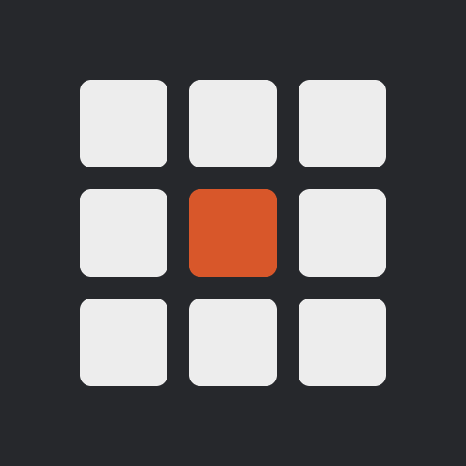
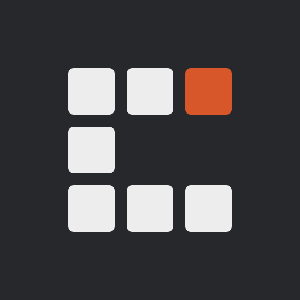

# Brand guidelines

Version 1.0, Chroniton Labs and ChronitonDB.

These guidelines cover the logos, colours, type and web usage for Chroniton Labs and its projects. Use them for websites, documentation, slides and anything else that carries the names.

## 1. Brand architecture

Chroniton Labs is the parent identity. Each project has its own mark. All marks are drawn on the same three by three grid of rounded cells. The Labs mark fills the whole grid, and each project mark is a shape cut from it. Every mark has exactly one orange cell.

| Parent | Project |
|---|---|
|  |  |
| Chroniton Labs | ChronitonDB |

## 2. Logos

Each identity has a square mark and a horizontal lockup. Use the lockup where there is room, and the mark on its own for avatars, favicons and tight spaces. Use the light files on light backgrounds and the dark files on dark backgrounds.

<p>
  <picture>
    <source media="(prefers-color-scheme: dark)" srcset="chronitonlabs/chroniton-labs-lockup-dark.svg">
    
  </picture>
</p>
<p>
  <picture>
    <source media="(prefers-color-scheme: dark)" srcset="chronitondb/chronitondb-lockup-dark.svg">
    
  </picture>
</p>

## 3. Construction

| Element | Measurement |
|---|---|
| Artboard | 64 × 64 units |
| Cell | 16 × 16 units, corner radius 2 |
| Gap between cells | 4 units |
| Margin | 4 units on every side |
| Wordmark | Starts 14 units after the last cell. Its cap height is 32 units, centred on the mark. |
| Orange cell | Exactly one per mark. Labs puts it in the centre. ChronitonDB puts it top right. |

## 4. Clear space and minimum size

Leave clear space equal to one cell (a quarter of the mark's height) on every side of a mark or lockup. Keep other text, logos and edges outside it.

| Logo | Minimum size |
|---|---|
| Chroniton Labs mark | 24 px |
| ChronitonDB mark | 16 px |
| Chroniton Labs lockup | 160 px wide |
| ChronitonDB lockup | 140 px wide |

At 16 and 32 px, render marks at whole pixel multiples of 16 so the cells stay sharp.

## 5. Colour

There are three colours and no others. Charcoal and off-white carry almost everything. Orange is the accent: use it sparingly, one element per view where possible.

| Colour | Hex | RGB | Use |
|---|---|---|---|
| Charcoal | `#26282C` | 38 40 44 | Text and marks on light backgrounds. Dark backgrounds. |
| Off-white | `#EDEDED` | 237 237 237 | Text and marks on dark backgrounds. Light backgrounds. |
| Orange | `#D8572A` | 216 87 42 | The accent cell, focus rings, hover states, one highlight. |

| Pair | Contrast ratio | Use |
|---|---|---|
| Charcoal on off-white | 12.6 : 1 | All text |
| Off-white on charcoal | 12.6 : 1 | All text |
| Orange on charcoal | 3.7 : 1 | Large text (24 px and up) and graphics only |
| Orange on off-white | 3.4 : 1 | Large text (24 px and up) and graphics only |

Never set body text in orange, and never put text on an orange fill. Neither pair reaches the 4.5 : 1 needed for normal sized text.

## 6. Typography

Use Schibsted Grotesk, the logo font, for all text. It is free under the SIL Open Font License, from [Google Fonts](https://fonts.google.com/specimen/Schibsted+Grotesk). Use Regular (400), Medium (500) and Bold (700). Code is the only exception: set it in the system monospace font.

| Style | Size / line height | Weight | Letter spacing | Example |
|---|---|---|---|---|
| Display | 56 / 60 | 700 | −0.02em | Distributed by default |
| Heading 1 | 40 / 48 | 700 | −0.02em | Getting started |
| Heading 2 | 28 / 36 | 700 | −0.015em | Configure the cluster |
| Heading 3 | 20 / 28 | 700 | | Replication settings |
| Body | 17 / 28 | 400 | | Each node owns a range of tokens. |
| Small | 14 / 22 | 500 | | Last updated 26 October 2026 |
| Label | 13 | 500 | +0.08em, capitals | DOCUMENTATION |
| Code | 15 / 24 | system monospace | | `nodetool status` |

## 7. On the web

- Buttons are charcoal on light pages and off-white on dark pages. Corner radius is 4 px, which matches the rounding of the cells.
- Links keep the text colour and get an orange underline. On hover the link text turns orange.
- Focus rings are a 2 px orange outline, offset 3 px from the element.
- In READMEs, swap the light and dark lockups with a `<picture>` element, as shown in section 10.

## 8. Marks for new projects

1. Draw the mark on the three by three grid from section 3, with no changes to cell size, gap or radius.
2. Use between three and eight cells. The full nine cell grid belongs to Chroniton Labs.
3. Make exactly one cell orange and the rest charcoal or off-white.
4. Base the shape on the project's initial or a simple idea from the project, and make sure it differs clearly from every existing mark.
5. Set the wordmark in Schibsted Grotesk Bold, convert it to shapes, and build the lockup to the measurements in section 3.
6. Check the mark at 16 and 32 px on light and dark backgrounds before you publish it.

## 9. Don't

- Recolour, stretch, rotate or outline the marks, or add shadows or gradients.
- Move the orange cell, or add a second one.
- Retype a wordmark in live text. Use the supplied SVG files.
- Place a mark on an orange fill or on a busy photograph.
- Lock up the marks with third party logos, including AxonOps branding.
- Use the Chroniton Labs mark as the logo of a single project.

## 10. Tokens and snippets

CSS custom properties:

```css
:root {
  --chroniton-charcoal: #26282C;
  --chroniton-offwhite: #EDEDED;
  --chroniton-orange:   #D8572A;
  --chroniton-font: "Schibsted Grotesk", system-ui, sans-serif;
  --chroniton-font-mono: ui-monospace, SFMono-Regular, Menlo, Consolas, monospace;
  --chroniton-radius: 4px;
}

/* Google Fonts */
@import url("https://fonts.googleapis.com/css2?family=Schibsted+Grotesk:wght@400;500;700&display=swap");
```

Light and dark lockup in a README:

```html
<picture>
  <source media="(prefers-color-scheme: dark)" srcset="https://github.com/chronitonlabs/brand/raw/main/chronitondb/chronitondb-lockup-dark.svg">
  
</picture>
```

## 11. Files

See the [README](README.md#contents) for every file in this repository and what it is for.
